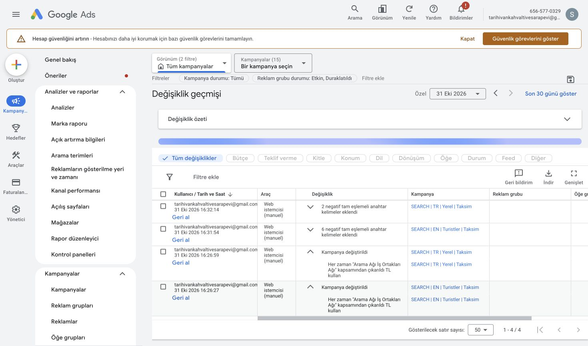

# Google Ads incelemesi ve uygulama — 31 Ekim 2026

Hesap: Tarihi Van Kahvaltı Evi 1978 / 656-577-0329. Performans dönemi: **1–30 Ekim 2026**, Türkiye saati. Kaynaklar: açık Chrome oturumundaki kampanya, ağ, reklam, dönüşüm, EN konum/saat, site bağlantıları ve değişiklik geçmişi ekranları; indirilen 5.983 sorgu ve 459 negatif kayıt. İndirilen dosyalar yerel `output/ads-2026-10-31` klasöründe saklandı. Bunlar geçmiş performanstır; bugünkü düzenlemelerin sonucu değildir.

## Sonuç ve uygulanmış değişiklikler

İki Arama kampanyasında Google Arama iş ortakları kapatıldı. Görüntülü ağ zaten kapalıydı. İngilizce kampanyaya altı, Türkçe kampanyaya iki **tam eşlemeli** negatif eklendi. Negatif tablosu 459 → 465 → 467 oldu. Dört işlem de 31 Ekim değişiklik geçmişinde doğrulandı:

| Saat | İşlem |
|---|---|
| 16:26:27 | EN: Arama Ağı İş Ortakları Ağı kapsamından çıkarıldı |
| 16:26:59 | TR: Arama Ağı İş Ortakları Ağı kapsamından çıkarıldı |
| 16:31:54 | EN: 6 negatif tam eşlemeli anahtar kelime eklendi |
| 16:32:14 | TR: 2 negatif tam eşlemeli anahtar kelime eklendi |



Bütçe, teklif stratejisi, TBM tavanı, konum ve yayın saatleri değiştirilmedi. Duraklatılmış kampanyalar açılmadı. Yeni ücretli kampanya başlatılmadı.

Site tarafında Yandex Haritalar bağlantıları yol tarifi tıklaması ölçümüne eklendi. Google Maps kısa bağlantıları da destekleniyor. Harita/WhatsApp adını başka bir sitenin adresi veya sorgusunda içeren bağlantıların yanlış dönüşüm üretmesi engellendi. Bunlar mevcut **ikincil** iletişim aksiyonlarıdır; rezervasyon/satış olarak gönderilmez. Müşteri bilgileri analitiğe eklenmedi.

## Kampanyalar ve maliyet

| Kampanya | Güncel durum | Günlük ortalama bütçe | Tıklama | Gösterim | Maliyet | Ads dönüşümü |
|---|---|---:|---:|---:|---:|---:|
| SEARCH / EN / Turistler / Taksim | Etkin, teklif stratejisiyle sınırlı | 2.000 TL | 2.142 | 29.370 | 38.267,53 TL | 163 |
| SEARCH / TR / Yerel / Taksim | Etkin | 1.100 TL | 1.722 | 14.888 | 32.488,43 TL | 86 |
| Tarihi Van Kahvaltı Evi 1978 | Etkin / Akıllı | 250 TL | 1.227 | 91.322 | 4.798,72 TL | 110 |
| Genel Trafik Reklam | Duraklatıldı / PMax | 1.000 TL | 4.798 | 109.371 | 6.886,37 TL | 145 |
| PMAX / Yerel Ziyaret / Beyoğlu Test | Duraklatıldı | 500 TL | 124 | 2.783 | 1.552,06 TL | 33 |

Hesap özeti: **10.013 tıklama, 247.734 gösterim, 83.993,11 TL maliyet**. Arama ikilisi: 70.755,96 TL, 3.864 tıklama; EN TO %7,29, TR TO %11,57. Etkin üç kampanyanın toplam ortalama bütçesi 3.350 TL/gün; bu kesin günlük fatura tavanı değildir. Duraklatılmış PMax bütçeleri etkin toplama dahil edilmedi.

EN önceki 30 güne göre 17.865,68 TL / %87,57; TR 4.742,30 TL / %17,09 daha fazla harcamış. Bu fark tek başına kötü performans ya da bugünkü ayarların etkisi değildir. Bütçe geçmişi ve müşteri gelirleriyle eşleştirme yapılmadan kârlılık sonucu çıkarılamaz.

Arama ortakları: EN 7 tıklama / 23,48 TL / 0 dönüşüm; TR 3 tıklama / 3,76 TL / 0 dönüşüm. Kapatma, projedeki Google Arama odaklı kanal tercihine uygundur. Hacim çok küçük olduğundan büyük tasarruf veya istatistiksel performans üstünlüğü iddiası yoktur.

## Ölçüm: 537 dönüşüm, 537 rezervasyon değildir

Kampanya satırlarının toplamı 537 Ads dönüşümü gösteriyor. Dönüşüm envanterinde ise web rezervasyon talebi **12**, WhatsApp tıklaması **11**, web telefon tıklaması **5**, web yol tarifi tıklaması **311**. Web rezervasyonu birincil; diğer üç web iletişim aksiyonu ikincil. WhatsApp artık **Etkin**; 23 Ekim raporundaki uyarı bu oturumda görünmedi. Bu gözlem, sahte test dönüşümü gönderilerek elde edilmedi.

Diğer aksiyonlar: Google yerel yol tarifi 929; Business profile Directions 56; Business profile Call 52; Clicks to call 12; Menu views 526; Other engagements 10.572; web sitesi ziyaretleri 60; Orders 6; modellenmiş Store visits 135,50. Tüm aksiyonların toplamı 12.687,50. Bu kapsam, kampanya tablosunun birincil dönüşümleriyle aynı değildir; toplamlar birbirine eklenmez. Aksiyon başına 1 değer, 1 TL gerçek satış değildir.

Her iki Arama kampanyasında güncel hedefler kampanyaya özel **randevu rezervasyonu + telefon aramasıyla elde edilen potansiyel müşteri**. Önceki denetimde çıkarılan yerel yol tarifi hedefi yeniden eklenmedi. Reklamlardan sesli arama ve Smart arama aksiyonlarında hâlâ daha önce kaydedilmiş dönüşüm yok. Telefon varlığındaki tıklama sayısı cevaplanmış arama sayısı olarak yorumlanmamalı.

12 talep ile gerçekleşen ziyaret, kişi sayısı ve hesap tutarı eşleştirilmeden gerçek müşteri edinme maliyeti hesaplanamaz. Görünürlük/tıklama odaklı stratejilerden dönüşüm odaklı teklife toplu geçiş yapılmadı. Google'ın [birincil/ikincil aksiyon açıklaması](https://support.google.com/google-ads/answer/11461796?hl=tr) ve [kampanya hedefleri](https://support.google.com/google-ads/answer/10995103?hl=tr) bu ayrımın temelidir.

## Arama niyeti ve negatifler

CSV'nin EN sorgu satırları 4.074 kayıt / 1.588 tıklama / 27.491,64 TL; TR 1.252 kayıt / 1.153 tıklama / 21.482,12 TL. Kalan sorgu satırlarında PMax trafiği var. Görünen sorgular kampanya maliyetinin tamamını açıklamaz; gizlilik nedeniyle gösterilmeyen aramalar ve rapor kapsamı dikkate alınmalıdır. Sorgu maliyetlerini kampanya toplamı diye sunmadım.

Korunan örnekler: EN `breakfast near me` 596 tıklama / 10.155,30 TL / 68 Ads dönüşümü; `kahvaltı near me` 68 / 986,45 TL / 9; `turkish breakfast near me` 52 / 860,27 TL / 10. TR `van kahvaltı evi` 103 / 1.865,59 TL / 3. Marka sorgusu `tarihi van kahvaltı evi 1978` 653,90 TL ve sıfır dönüşüm göstermesine rağmen dışlanmadı: markayı engellemek niyet bakımından yanlış olur.

EN'e eklenen tam negatifler:

```text
[good breakfast buffet near me]
[breakfast buffet near me]
[buffet breakfast near me]
[breakfast buffet istanbul]
[best breakfast in istanbul with sea view]
[istanbul kahvaltı mekanları boğaz]
```

TR'ye eklenen tam negatifler:

```text
[istanbul boğaz kahvaltı mekanları]
[karaköy kahvaltı vapur]
```

Bu sekiz sorgu önceki CSV'de hariç tutulmamıştı; aynı kampanyalarda birebir negatifleri yoktu. EN altı sorgunun geçmiş maliyeti 116,71 TL, TR ikisinin 52,29 TL; toplam **169,00 TL / sıfır Ads dönüşümü**. Gerekçe az sayıdaki sıfır dönüşüm değil, açık büfe/deniz manzarası/vapur beklentisinin işletmenin teklifine uymamasıdır. Gelecekte 169 TL tasarruf garantisi yoktur. Genel `kahvaltı`, `breakfast`, `menemen`, `near me`, marka veya semt sözcükleri topluca engellenmedi. [Google negatif eşleme kuralları](https://support.google.com/google-ads/answer/2453972?hl=tr).

## Reklam, öğe, konum ve saat bulguları

EN en çok harcayan reklam: 1.337 tıklama / 24.013,47 TL / 92 Ads dönüşümü, Uygun ve İyi. İkinci EN reklam: 691 / 12.146,98 TL / 70, Uygun ve Ortalama. TR ana reklam: 1.259 / 23.639,06 TL / 43; ikinci: 302 / 6.143,59 TL / 42, ikisi de Uygun ve Ortalama. İkinci metinlerde raporlanan dönüşüm oranı yüksek olsa da farklı sorgular ve geçmiş hedef değişiklikleri nedeniyle kontrollü deney sonucu gibi sunulmadı; ana reklamlar kapatılmadı. Final URL'ler TR `/`, EN `/en`; görünen reklam yolu gerçek URL değildir.

EN kampanya sitelinkleri İngilizce ve Uygun: View Menu, Breakfast Guide, Serpme Breakfast for Two, Breakfast for One, Directions & Location, Our Story Since 1978, Visitor Questions, Request a Table. Directions & Location hedefi `/en#location`; İngilizce sayfa içi hedef olduğundan yanlışlıkla bozuk veya Türkçe diye değiştirilmedi. Rezervasyon öğesi WhatsApp teyidini açıkça anlatıyor. Hesapta mevcut uygun telefon öğeleri var, yinelenen öğe eklenmedi. Öğe satırları aynı reklam gösterimine/tıklamasına birlikte bağlanabileceği için maliyetleri toplayıp ek harcama hesaplanmaz.

EN konum raporu: Beyoğlu 19.127,96 TL / 100 Ads dönüşümü; Fatih 10.141,72 TL / 16; Şişli 6.616,79 TL / 40; Beşiktaş 2.230,91 TL / 7. Fatih'in raporlanan CPA'sı 633,86 TL, Beyoğlu 191,28 TL. Gerçek talep/ziyaret ayrımı olmadan Fatih kapatılmadı. Bunlar hedeflenen konum satırlarıdır, kesin fiziksel kullanıcı konumu değildir; satır toplamı 38.117,38 TL, kampanya toplamı 38.267,53 TL'dir.

EN her gün 07:00–22:00 yayın yapıyor. Hafta sonu 12.697,01 TL / 89 Ads dönüşümü; Perşembe+Cuma 11.043,36 TL / 10. Bu fark rezervasyon bazında tekrar incelenmeli. İşletmenin çalışma saatleriyle uyumlu mevcut plan, karışık geçmiş dönüşümlere dayanarak daraltılmadı.

## Doğrulama ve izleme

- Değişiklik geçmişi dört canlı işlemi doğruladı; negatif toplamı 467.
- `npm run test:analytics`, `npm run lint`, `npm run build`: başarılı.
- Ana çalışma klasöründe geniş `npm test`: güvenlik, analitik, Web Vitals ve rezervasyon testleri geçti; `test:site`, `/rezervasyon: şema SSS sayısı yanlış` kontrolünde durdu. Başlangıçtan beri commit edilmemiş sipariş SSS değişiklikleri var; bu dosyalar bu çalışmanın commit'ine alınmadı.
- **İzole doğrulama:** `6294915` tabanlı temiz geçici checkout'a yalnız bu çalışmanın `analytics.ts` ve `test-analytics.mjs` dosyaları aktarıldı. `npm run lint`, standart Turbopack `npm run build` ve tam `npm test` başarılı (çıkış kodu 0). 36 kanonik sayfa, 342 bölüm bağlantısı, 100 sitemap görseli, 142 ürün/18 kategori ve güvenlik/rezervasyon/analitik kontrolleri geçti. Böylece gönderilecek kod, yerel SEO değişikliklerinden bağımsız doğrulandı.
- Canlı siteye test rezervasyonu, sahte reklam tıklaması veya sahte dönüşüm gönderilmedi. Yerel testler geçici depolama kullanır. Canlı dağıtım sonrası etiketin Google'a ulaşması bu yerel testlerden çıkarılamaz.

7–14 gün sonra aynı kapsamda son 7 gün/önceki 7 gün karşılaştırması yapılmalı: kampanya bazında harcama, web talebi, WhatsApp, gerçek arama ve teyitli gelen masa ayrı takip edilmeli. Negatiflerin etkisi yalnız engelledikleri sorgularda değerlendirilmeli. Kampanya hedefleri değişmiş dönemlerin genel CPA'ları doğrudan kıyaslanmamalı. Akıllı kampanyanın 110 dönüşümü de işletme kayıtlarıyla doğrulanmalı; sırf TO düşük diye duraklatılmadı. Satış/ziyaret verisi olmadan bütçe artırma, yeni kampanya açma veya kârlılık garantisi verilmedi.

Kapsam sınırı: projenin dosya envanteri, talimatları, işletme bilgileri, önceki denetimleri, analitik ve rezervasyon akışı incelendi. Tüm ikili görsellerin ve her arayüz/kod satırının tek tek okunup denetlendiği iddiası yoktur. Ads'te tüm 15 kampanyanın her alt ekranı, TR konum/saat kırılımı, gerçek müşteri kayıtları ve ayrıntılı arama görüşmeleri bu oturumda doğrulanmadı. Bazı Ads ekranları geç yüklendi; reklam engelleyici uyarısı vardı.
